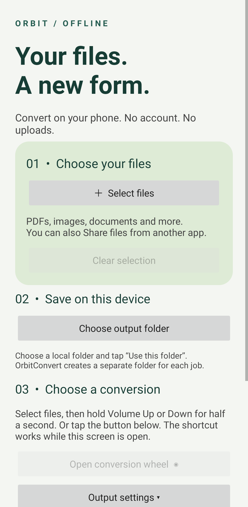
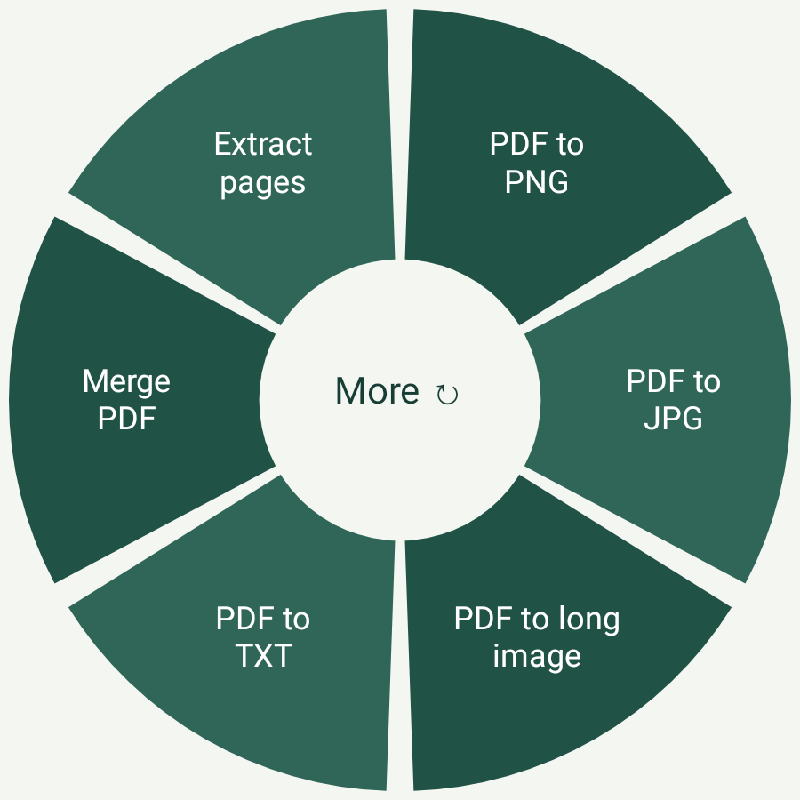

# [⬇ Download Orbit Convert v0.1.0 APK](./OrbitConvert-0.1.0.apk?raw=true)

Android 8.0+ · Android pilot · Debug build

## Shout-out to Filee

A big shout-out to **[Myeonggu Kim (KnifeLemon)](https://github.com/KnifeLemon)**, the creator of **[Filee](https://github.com/KnifeLemon/Filee)**, and its contributors. Filee's offline conversion tools and donut-shaped menu inspired this Android project. Thank you for sharing your work as open source!

# Orbit Convert — Android Pilot

Local file conversion with a touch-friendly radial menu. This pilot brings the Filee-inspired workflow to Android with the features below.

## Features

- **Offline and account-free:** no signup, Google Drive connection, uploads, or internet permission.
- **Volume-button shortcut:** select files, then hold Volume Up or Down to open the donut inside the app. A touch button is also available.
- **Android file sharing:** select multiple files through the file picker or use **Share → Orbit Convert** from another app.
- **Local folder access:** choose an output folder through Android's permission prompt. Original files stay unchanged.
- **Image conversion:** export JPG, PNG and WEBP; resize, adjust quality, apply grayscale, or use a fixed-ratio center crop.
- **PDF tools:** combine images into a PDF, export PDF pages as images, stitch pages into **one long image**, merge or split PDFs, select page ranges, and extract existing text.
- **Text and documents:** convert UTF-8 text to PDF, basic DOCX or HTML, and extract DOCX body text.
- **Tables and subtitles:** convert CSV/TSV tables and JSON object arrays; convert SRT and VTT subtitles.
- **ZIP and media tools:** create or extract ZIP files, extract supported AAC audio to M4A, and save a video's first frame as JPG.
- **Batch and recent results:** reorder files, cancel a conversion, and open or share recent outputs.

## Rendered App Previews

| Home screen | Conversion wheel |
| :---: | :---: |
|  |  |
